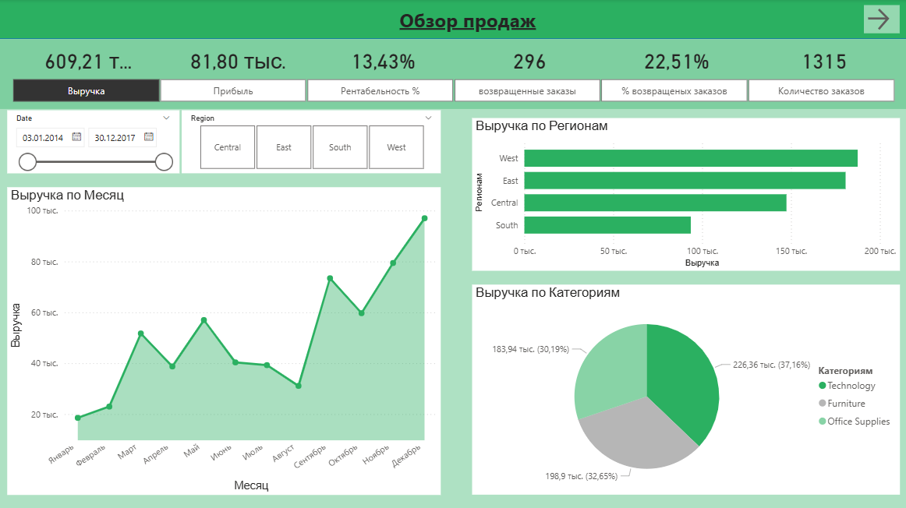
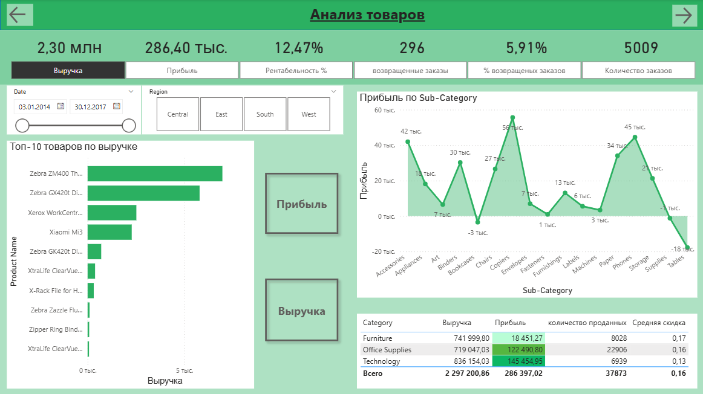
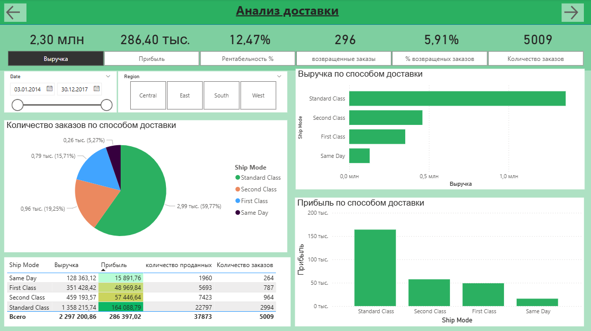
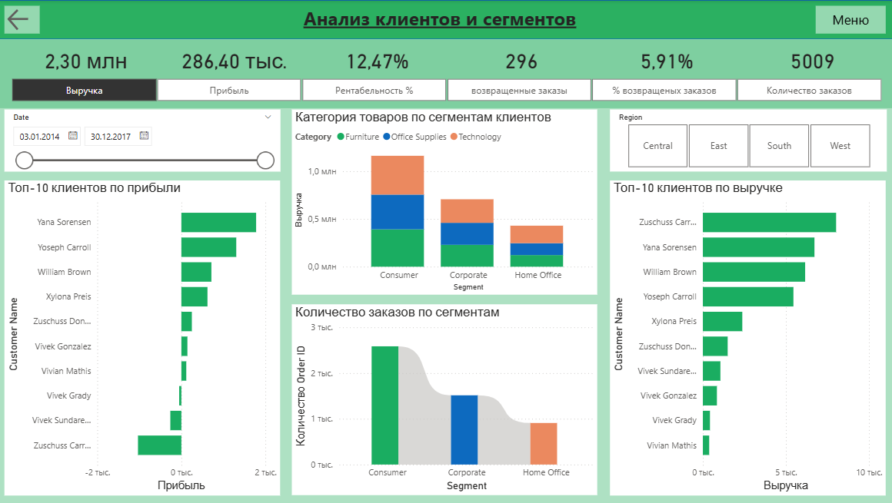

# Sales-Dashboard-Power-Bi
Interactive Sales Dashboard created in Power BI to analyze sales performance, profitability, products, customers, and delivery.

##🎯 Project Overview 
The purpose of this project is to analyze sales data and transform it into meaningful insights through interactive visualizations and key performance indicators (KPIs). 

##📑 Dashboard Pages
-Dashboard Menu The main navigation page that provides access to different sections of the report.

-Sales Overview An overview of key sales metrics, revenue, profit, and overall business performance.

-Product Analysis An analysis of product performance, sales distribution, and profitability.

-Delivery Analysis An overview of delivery performance and shipping-related metrics.

-Customer and Segment Analysis An analysis of customer behavior, customer segments, and their contribution to sales.

##🛠️ Tools & Technologies 
- Microsoft Power BI 
- DAX
- Power Query
- Data Visualization 
- Business Intelligence

##📈 Key Metrics 
- Total Sales
- Total Profit
- Profit Ratio
- Sales by Product 
- Sales by Customer
- Delivery Performance

🖼️ Dashboard Preview Screenshots of the dashboard pages are available in this repository.

👩‍💻 Project Purpose This project demonstrates practical skills in data analysis, interactive dashboard development, data visualization, and business intelligence using Power BI.

## 🖼️ Dashboard Preview

### 1. Dashboard Menu

### 2. Sales Overview

### 3. Product Analysis

### 4. Delivery Analysis

### 5. Customer and Segment Analysis

